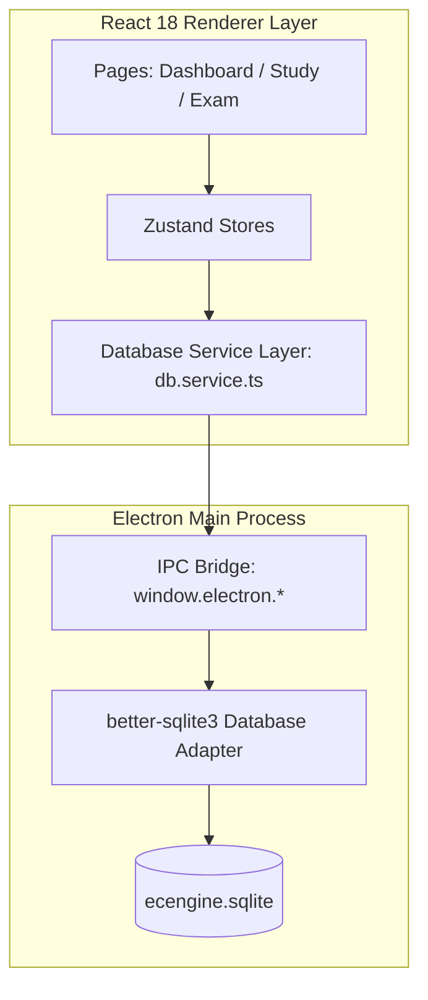

<div align="center">
  
  <h1>⚡ ECEngine</h1>
  <p><strong>The Ultimate Cyberpunk-Utility Study Command Center for the Philippine Electronics Engineering (ECE) Licensure Exam</strong></p>
  
  <p>
    
    
    
    
    
    
  </p>
</div>

---

ECEngine is an offline-first desktop application engineered for examinees preparing for the Philippine Electronics Engineering (ECE) and Electronics Technician (ECT) Licensure Exams. It combines a local SQLite database with advanced spaced repetition (SM-2) algorithms to provide an integrated study environment. The application supports standard flashcards, multiple-choice questions (MCQs), and LaTeX-rendered formula sets, utilizing a tech stack comprised of Electron, React 18, TypeScript, and Vite. State management is handled by Zustand, styling via Tailwind CSS with custom CSS properties, and animations by Framer Motion. 

---

## 🚀 Features

### Study Modes
* **Spaced Repetition**: Flashcard and formula sets utilize the SM-2 algorithm, providing Again / Hard / Good / Easy rating buttons to schedule reviews.
* **Preview Mode**: Browse formula sets without writing SM-2 progress data.
* **Written Mode**: Require typing the exact answer before flipping the flashcard.
* **Autoplay Mode**: Hands-free flashcard review loop powered by native TTS — Web Speech API on Windows/macOS (no setup required), Piper neural TTS on Linux (requires separate installation, see Linux TTS Setup below).
* **Additional Controls**: Swap Term/Definition toggle, shuffle toggle, and bookmarking for filtered reviews.
* **Keyboard Shortcuts**: Use `Space`, `ArrowUp`, or `ArrowDown` to flip cards; `1-4` to select an SM-2 rating; and left/right arrow keys to navigate.

### Card Types
* **Flashcard**: Standard front/back layout with an optional image and an optional explanation field (with optional image).
* **MCQ**: Structured with a question, 4 multiple-choice choices, correct answer, optional image, and an optional solution field (with optional image).
* **Formula**: Specialized layout containing the formula name, LaTeX equation (rendered via KaTeX and MathLive), description, variables, and an optional explanation field (with optional image).
* **Explanation Field**: A collapsible section available on the back face of flashcard, formula, and MCQ card types. It supports text with LaTeX rendering and an optional image. When expanded, the SM-2 rating buttons and navigation buttons are hidden to maximize reading space.

### Deck Management
* **Add Decks**: Create MCQ, Flashcard, or Formula sets with features including drag-and-drop card reordering (via DnD Kit), undo history, bulk import for MCQs and Flashcards, and MathLive equation editors for individual fields.
* **Edit Deck**: Provides the same comprehensive capabilities as the Add Decks interface for modifying existing decks.
* **Folder System**: Support for nested folders (maximum depth of 1), independently scoped for the study and formula tabs.
* **Smart Routing**: After saving, the application automatically redirects to the correct tab based on the deck type (Formula decks route to the Formulas tab, others route to Flashcards).
* **Source Tags**: Pre-configured source tags include Excel, Edge, TOP, Pinoybix, Indiabix, EST Superbook, and Cuervo, alongside custom user-defined tags.

### Analytics & Progress
* **Dashboard Heatmap**: A visual study activity heatmap plotting activity over a 6-month window.
* **Accuracy Trends**: Line charts mapping accuracy trends across the core subjects (MATH, GEAS, ELECS, EST).
* **Mastery Intelligence**: Mastery percentage calculated per subject and per individual deck, derived directly from SM-2 progress data.
* **Board Exam Countdown**: A built-in timer counting down to the user's exam date.

### AI Integration
* **Groq GPT-OSS-120B Integration**: Features an explain button on MCQ cards in Learn and Test modes. Requires a user-supplied Groq API key configured in Settings.
* **Context Extraction**: A "Get Context" button instantly copies a structured prompt to the clipboard for use in external AI tools like ChatGPT or Claude.

### Print & Export
* **Print Views**: Generate layouts optimized for Glossary, Table, or Q&A formats.
* **Theming**: Select between Light, Sepia, and Dark print themes.
* **Direct Export**: Native capability to export directly to PDF or export deck contents to a raw text file.

### Settings & Customization
* **Custom Images Storage Path**: Configure a custom directory for image files (such as card diagrams and explanation images). Fully supports native folder browsing as well as direct text path copy-pasting. (Available under Settings → Data & Sync → Unlock Advanced).
* **Linux Platform Compatibility**: Features case-insensitive file resolution for image protocol handlers (`ece-app://`), correcting Chromium's automatic hostname lowercasing on case-sensitive Linux filesystems. Also features a dedicated native TTS backend (Piper) bypassing Chromium's lack of Web Speech API support on Linux (see Linux TTS Setup).

---

## 🏗 System Architecture

ECEngine runs as a native desktop application powered by React 18, Vite, Electron, and a local SQLite database compiled for desktop distribution.



### Database Schema

```sql
CREATE TABLE topics (
  id TEXT PRIMARY KEY,
  name TEXT NOT NULL,
  subject TEXT NOT NULL,
  description TEXT,
  parent_id TEXT,
  order_index INTEGER DEFAULT 0,
  tags TEXT,
  created_at INTEGER DEFAULT (strftime('%s', 'now')),
  folder_name TEXT DEFAULT 'Uncategorized',
  folder_id TEXT REFERENCES folders(id) ON DELETE SET NULL,
  FOREIGN KEY(parent_id) REFERENCES topics(id)
);

CREATE TABLE cards (
  id TEXT PRIMARY KEY,
  topic_id TEXT NOT NULL,
  type TEXT NOT NULL,
  data TEXT NOT NULL,
  difficulty TEXT,
  tags TEXT,
  is_custom BOOLEAN DEFAULT 0,
  created_at INTEGER DEFAULT (strftime('%s', 'now')),
  FOREIGN KEY(topic_id) REFERENCES topics(id)
);

CREATE TABLE progress (
  card_id TEXT PRIMARY KEY,
  ease_factor REAL DEFAULT 2.5,
  interval INTEGER DEFAULT 1,
  repetitions INTEGER DEFAULT 0,
  next_review TEXT,
  last_reviewed TEXT,
  FOREIGN KEY(card_id) REFERENCES cards(id)
);

CREATE TABLE folders (
  id TEXT PRIMARY KEY,
  name TEXT NOT NULL,
  parent_id TEXT REFERENCES folders(id),
  order_index INTEGER DEFAULT 0,
  scope TEXT NOT NULL DEFAULT 'study'
);
```

---

## 📂 Project Directory Layout

```text
ecengine/
├── electron/                    # Electron Shell Files
│   ├── main.ts                  # App launch entry point, window configuration
│   ├── preload.ts               # contextBridge IPC boundaries
│   ├── ipc/                     # DB, file system, and system IPC handlers
│   └── db/                      # Schema and SQLite connections
├── src/                         # React Frontend Renderer Process
│   ├── assets/                  # Fonts, SVGs, Icons
│   ├── components/              # UI Components
│   │   ├── ui/                  # Reusable visual units
│   │   ├── mcq/                 # MCQ components
│   │   ├── flashcard/           # Flashcard and SM-2 components
│   │   ├── formula/             # Formula rendering components
│   │   ├── deck/                # Deck building and forms
│   │   └── layout/              # Sidebars and Navigation
│   ├── hooks/                   # Custom business logic React hooks
│   ├── pages/                   # Main page layout views
│   ├── services/                # Database Service Layer & connectors
│   ├── store/                   # Zustand store slices
│   └── styles/                  # Tailwind styling and CSS custom properties
├── scripts/                     # Operational scripts
├── package.json                 # Project manifest and dependencies
└── electron.vite.config.ts      # Vite build configuration
```

---

## 🛠 Getting Started & Developer Guide

### Prerequisites
* **Node.js**: `v18.x` or higher installed
* **npm** or **yarn** package manager
* **C++ Compiler Tools** (Required to compile native `better-sqlite3` bindings for Electron)
* **Linux only**: Piper TTS is required for the Read-Aloud/Autoplay feature — see Linux TTS Setup below. Not required to build or run the app; only affects the TTS feature specifically.

### Installation & Seeding

1. **Clone the Repository**:
   ```bash
   git clone https://github.com/vtajaros/ECEngine.git
   cd ecengine
   ```

2. **Install Node Modules**:
   ```bash
   npm install
   ```

3. **Compile and Seed the SQLite DB**:
   This processes the JSON metadata inside `content/` and compiles it into `ecengine.sqlite`:
   ```bash
   npm run seed
   ```

### Linux TTS Setup

This app does not bundle Piper or any voice models. On Linux, TTS requires manual setup:

1. Install Piper (Arch/AUR example — note for other distros the user should consult [https://github.com/rhasspy/piper](https://github.com/rhasspy/piper) directly):
   ```bash
   yay -S piper-tts-bin
   ```
2. Download a voice model (`.onnx` + matching `.onnx.json` sidecar file) from [https://huggingface.co/rhasspy/piper-voices/tree/main/en/en_US](https://huggingface.co/rhasspy/piper-voices/tree/main/en/en_US) — recommended: the "ryan" voice (medium quality) for a natural-sounding male US English voice, or "amy" for female.
3. In-app: Settings → Sound & Feedback → Reading Voice (Piper TTS) → Browse, and select the downloaded `.onnx` file. The app validates the `.onnx.json` sidecar exists automatically.
4. If Piper is not detected, the Settings panel shows install instructions directly — no auto-download is provided by design.

Playback requires `aplay` (part of `alsa-utils`, present by default on most Linux desktop distros).

### Developer Execution Reference

Use the following commands inside your terminal to launch, build, or test various components:

| Command | Action Description |
|---|---|
| `npm run dev` | Spin up Electron shell in development mode with Hot Module Replacement (HMR) |
| `npm run build` | Compile code and bundle React and Electron assets |
| `npm run preview` | Run a local preview of the compiled application |
| `npm run package` | Generate distributable native binary installers (`.exe`, `.dmg`, `.deb`) via electron-builder |
| `npm run validate-content` | Execute content validations over JSON files under `content/` |
| `npm run test` | Run active Unit Tests with Vitest |

---

## ⚠️ Known Limitations

* **Technical Debt in FlashCard.tsx**: The older LooksFam 3D flip view uses `FlashCard.tsx`, which does not have the SM-2 algorithm wired.
* **No Cloud Sync/Backup**: There is no automatic backup or cloud syncing. Data relies entirely on the local SQLite file.
* **Empty Formula Bank**: The formula bank content is not pre-populated. Users must create their own formula decks from scratch.
* **AI Provider Support**: Only the Groq API is implemented and wired. Mentioned support for Gemini or other multi-provider interfaces in older notes is not present.
* **No Bundled TTS on Linux**: Unlike Windows/macOS (which use the OS's built-in Web Speech API with zero setup), Linux TTS requires the user to separately install Piper and a voice model — this is a deliberate scope decision (see Linux TTS Setup), not a bug.

---

## 🤖 AI Auditor & Developer Manifesto

These instructions govern all future modifications to this repository:
1. **No Hex Color Coding**: All styling changes must use established CSS variables inside `src/styles/theme.css` (e.g., `var(--accent-primary)`). Do not add custom hex values.
2. **Access Proxying**: Direct browser `window.electron` calls inside React components should be avoided when possible. Route DB activities through `src/services/db.service.ts` for cleaner separation of concerns.
3. **Typography Standards**: Preserve monospaced readability. Titles must utilize `Orbitron` or `Rajdhani`, and data containers should display body copy in `IBM Plex Mono` or `JetBrains Mono`. No soft pastel or rounded visuals.
4. **TypeScript Rigidness**: Avoid typing bypasses (`any`). Ensure custom payloads are typed correctly within `src/types/` to prevent silent database runtime failures.
5. **Shared Study Views**: Formula sets and Flashcard sets share the `FlashcardSession` component — UI changes to the study view affect both.

---

<div align="center">
  <i>Developed for the Engineers of 2026. Non sibi sed aliis.</i>
</div>
