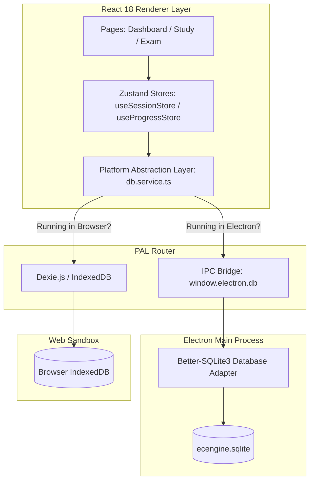

<div align="center">
  
  <h1>⚡ ECEngine</h1>
  <p><strong>The Ultimate Cyberpunk-Utility Study Command Center for the Philippine Electronics Engineering (ECE) Licensure Exam</strong></p>
  
  <p>
    
    
    
    
    
    
  </p>
</div>

---

**ECEngine** is a high-performance, cyberpunk-inspired offline-first study ecosystem specifically engineered for examinees preparing for the Philippine Electronics Engineering (ECE) and Electronics Technician (ECT) Licensure Exams. It transforms traditional review into a high-octane tactical workflow, empowering you to dominate the board exams with offline-first capabilities, advanced spaced repetition (SM-2), granular performance analytics, and dynamic formula reference tools.

---

## 📑 Table of Contents

- [⚡ ECEngine](#-ecengine)
  - [📑 Table of Contents](#-table-of-contents)
  - [🚀 Core Capabilities \& Feature Modules](#-core-capabilities--feature-modules)
    - [📊 Tactical Dashboard \& Telemetry](#-tactical-dashboard--telemetry)
    - [🧠 LooksFam Study Engine](#-looksfam-study-engine)
    - [📝 Exam Simulation Mode](#-exam-simulation-mode)
    - [🧪 Formulas \& Reference Laboratory](#-formulas--reference-laboratory)
    - [📥 Manifest Management (Import Pipeline)](#-manifest-management-import-pipeline)
  - [🔧 Recent Operational Changes \& UX Enhancements](#-recent-operational-changes--ux-enhancements)
  - [🏗 System Architecture \& Data Routing](#-system-architecture--data-routing)
    - [Platform Abstraction Layer (PAL)](#platform-abstraction-layer-pal)
    - [Data Models \& Schema Overview](#data-models--schema-overview)
  - [📂 Project Directory Layout](#-project-directory-layout)
  - [🛠 Getting Started \& Developer Guide](#-getting-started--developer-guide)
    - [Prerequisites](#prerequisites)
    - [Installation \& Seeding](#installation--seeding)
    - [Developer Execution Reference](#developer-execution-reference)
  - [🗺 Roadmap \& Future Strategic Improvements](#-roadmap--future-strategic-improvements)
  - [🤖 AI Auditor & Developer Manifesto](#-ai-auditor--developer-manifesto)

---

## 🚀 Core Capabilities & Feature Modules

### 📊 Tactical Dashboard & Telemetry
The Home Dashboard serves as your mission control, packing high-density study metrics into a consolidated cyberpunk console:
* **Heartbeat Heatmap**: A GitHub-style activity grid tracking active study time over a 6-month window leading up to your exam date. Color intensities transition dynamically from deep green (under 1 hour) to neon green (4+ hours).
* **Performance Telemetry Charting**: Real-time area and line charts (powered by Recharts) that map your historical accuracy scores. It automatically switches contexts between overall stats (`ALL`) and cumulative accuracy per specific engineering subject.
* **Core Subject Mastery Intelligence**: Dynamic calculation of mastery percentages for the four core ECE board subjects:
  1. **MATH**: Mathematics (Algebra, Calculus, Probability, Differential Equations, etc.)
  2. **GEAS**: General Engineering & Applied Sciences (Economy, Management, Thermodynamics, Materials, etc.)
  3. **ELECS**: Electronics Engineering (Semiconductors, Amplifiers, Circuits, Digital Logic, etc.)
  4. **EST**: Electronics Systems and Technologies (Analog/Digital Communications, Antennas, Fiber Optics, etc.)
* **Precision Mission Countdown**: A microsecond-accurate countdown timer pointing towards your designated Board Exam date, instilling focus and pacing.

### 🧠 LooksFam Study Engine
The heart of active recall and spaced repetition in ECEngine:
* **SM-2 Algorithmic Scheduling**: Integrates the SuperMemo-2 spaced repetition algorithm (`src/lib/sm2.ts`) to programmatically calculate optimal review intervals based on user feedback (`Again`, `Hard`, `Good`, `Easy`). It automatically updates `ease_factor`, `repetitions`, `interval`, and the `next_review` timestamp.
* **Unified Decks Structure**: Custom and preloaded decks can contain multiple card types, including traditional Flashcards, Multiple-Choice Questions (MCQs), and Formula sheets.
* **Partitioned Learning (Learn Mode)**: Focuses your review into manageable 5-card batches, enforcing perfect mastery by looping through incorrect cards until they are correctly answered before unlocking the next batch.
* **Zero-Lag Navigation (Test Mode)**: High-density scroll tracking keeps your position perfectly synced in extensive mock question banks, supporting frame-perfect interactions.
* **AI Explanation Sidebar**: Deconstructs questions into theoretical foundations, step-by-step mathematical derivations, and distractor option rationales.

### 📝 Exam Simulation Mode
Build test-taking stamina by simulating actual Professional Regulation Commission (PRC) exam conditions:
* **Custom Configurator**: Multi-select topics from the hierarchical ECE taxonomy, define question volume (25, 50, or 100 items), and allocate time limits.
* **Authentic Mock Conditions**: Randomizes question order and shuffles choice sequences. Answers are entirely hidden during the exam with active "Mark for Review" selectors.
* **Interactive Post-Exam Diagnostics**: Instant results breakdown featuring overall score, passing telemetry, detailed analysis of missed concepts, and the option to instantly re-run a customized session isolating only incorrect items.

### 🧪 Formulas & Reference Laboratory
A comprehensive mathematical vault for engineering relations:
* **Robust KaTeX Engine**: Fast, offline-first mathematical typesetting rendering complex multi-line integrals, Maxwell's relations, and communications formulas seamlessly. Includes automatic translation of unsupported LaTeX commands.
* **Hardened SVG & DOM Rendering**: Configured DOMPurify profiles that prevent complex radicals, fractions, and symbols from being stripped or deformed.
* **Granular Mastery Mapping**: Formulas carry their own spaced-repetition records, letting you track equation memorization on the same visual scale as standard conceptual flashcards.

### 📥 Manifest Management (Import Pipeline)
Easily import high-quality study materials:
* **Flexible Parser**: Ingests raw text, Anki-style tab-separated values (TSV), structured native JSON schemas, and formatted text blocks.
* **Cyberpunk Folder Hierarchy**: Categorize custom decks into nested folders complete with customizable color tags.
* **Navigation Protection**: Integrates React Router `useBlocker` handlers, warning you and blocking accidental navigation that would lose progress during active study or deck configuration.

---

## 🔧 Recent Operational Changes & UX Enhancements

We have recently refactored the UI and added highly requested functional capabilities to polish desktop and web experiences:

1. **Integrated Deck Keyword Search & Sorting**:
   * Added a real-time keyword search bar at the top of the deck browser, matching characters against deck and folder names.
   * Introduced comprehensive sorting options, enabling developers and students to sort decks dynamically by **Date Ascending** or **Date Descending** to manage growing libraries.
2. **Visual Layout Refinements**:
   * Adjusted folder navigation icon heights, making the pencil/edit icon perfectly proportional to the folder name text size.
   * Tightened vertical gaps: removed the excessive spacing between the first row of decks and the legend/controls header. This layout adjustment is uniformly applied across **LooksFam**, **Flashcards**, and **Formulas** views.
   * Spaced out navigation tabs in the main sidebar to provide a cleaner, more readable hierarchy.
3. **Adaptive Mobile & Tablet Optimization**:
   * **Tablet Landscape (iPad)**: Centered and balanced deck builder blocks when a landscape tablet viewport is detected, preserving full-width desktop visuals.
   * **Mobile Portrait view**:
     * Removed the redundant sub-header text ("study add decks") under the main `ADD DECKS` title.
     * Aligned cancel and save button heights for symmetrical tactile inputs.
     * Stacked the deck creation type selectors (MCQ, Flashcard, and Formula buttons) vertically, avoiding text clipping on narrow screens.
4. **Context-Aware Save Prompts**:
   * The warning instructing users to add a title and at least one card is now elegant and contextual: it is hidden by default and only triggers on hover over the disabled Save button or when an incomplete save is actively attempted.
5. **Architectural Quality Assurance Audit**:
   * Executed a full code review mapping component sizes, identifying render hotspots (such as isolating countdown loops), and proposing Zod schema integrations to guard SQLite database IPC responses.

---

## 🏗 System Architecture & Data Routing

ECEngine runs a hybrid architecture designed to compile to a local desktop shell or deploy to the web as a static Single Page Application (SPA).



### Platform Abstraction Layer (PAL)
All state actions fetch and write database records using the unified interface in `src/services/db.service.ts`. The interface automatically routes operations to the target database:

```typescript
// db.service.ts implementation pattern
export interface DBAdapter {
  getCards(topicId: string, type?: CardType): Promise<Card[]>;
  getProgress(cardId: string): Promise<Progress | null>;
  saveProgress(progress: Progress): Promise<void>;
  getTopics(): Promise<Topic[]>;
  importCards(cards: Card[]): Promise<void>;
  getExamSession(id: string): Promise<ExamSession>;
  saveExamSession(session: ExamSession): Promise<void>;
}
```

### Data Models & Schema Overview
Source content is saved in structured JSON blocks under `content/` before compiling into the SQLite structure:

```sql
-- Core Topic Directory
CREATE TABLE topics (
  id TEXT PRIMARY KEY,
  name TEXT NOT NULL,
  subject TEXT NOT NULL,
  parent_id TEXT REFERENCES topics(id),
  order_index INTEGER
);

-- Flexible JSON Cards Table
CREATE TABLE cards (
  id TEXT PRIMARY KEY,
  topic_id TEXT REFERENCES topics(id),
  type TEXT CHECK(type IN ('flashcard','mcq','formula','concept')),
  data JSON NOT NULL,
  difficulty TEXT,
  tags TEXT,
  is_custom INTEGER DEFAULT 0,
  created_at TEXT DEFAULT CURRENT_TIMESTAMP
);

-- SM-2 Spaced Repetition Analytics Tracker
CREATE TABLE progress (
  card_id TEXT REFERENCES cards(id),
  user_id TEXT DEFAULT 'local',
  ease_factor REAL DEFAULT 2.5,
  interval INTEGER DEFAULT 1,
  repetitions INTEGER DEFAULT 0,
  next_review TEXT,
  last_reviewed TEXT,
  PRIMARY KEY (card_id, user_id)
);
```

---

## 📂 Project Directory Layout

```text
ecengine/
├── content/                     # Source of truth JSON files (Topics, MCQs, Formulas)
│   ├── README.md                # Markdown documentation for content schema
│   ├── mathematics/             # Seeding JSONs for Algebra, Calculus, etc.
│   ├── electronics/             # Semiconductors, digital electronics, etc.
│   ├── communications/          # Analog/Digital systems, antennas, fiber
│   └── general-engineering/     # Economy, Management, and Laws
├── electron/                    # Electron Shell Files
│   ├── main.ts                  # App launch entry point, window, and security configurations
│   ├── preload.ts               # Secure contextBridge IPC boundaries
│   ├── ipc/                     # DB, file system, and system IPC handlers
│   └── db/                      # Schema, initialization queries, and SQLite connections
├── src/                         # Shared React Frontend SPA
│   ├── assets/                  # Fonts (Orbitron, Rajdhani, IBM Plex Mono), SVGs, Icons
│   ├── components/              # UI Components
│   │   ├── ui/                  # Visual units (Buttons, Cards, Modals)
│   │   ├── mcq/                 # MCQ cards, multiple choice buttons, explanations
│   │   ├── flashcard/           # Flippers, SM-2 selectors
│   │   ├── formula/             # KaTeX math render cards
│   │   └── layout/              # Sidebars, TitleBar, and Navigation units
│   ├── hooks/                   # Custom business logic React hooks (SM-2, timer, platform)
│   ├── pages/                   # Main page layout views (Dashboard, ExamMode, Study)
│   ├── services/                # Platform Abstraction Layer (PAL) & DB connectors
│   ├── store/                   # Zustand store slices (Session, Preferences, Progress)
│   └── styles/                  # Tailwind base styling and theme variable configuration
├── scripts/                     # Operational scripts (seeding DB, schema validators)
├── package.json                 # Project manifest, dependencies, and execution scripts
├── electron.vite.config.ts      # Unified compilation and hot module replacement config
└── vite.web.config.ts           # Web-specific standalone compilation instructions
```

---

## 🛠 Getting Started & Developer Guide

### Prerequisites
* **Node.js**: `v18.x` or higher installed
* **npm** or **yarn** package manager
* **C++ Compiler Tools** (Required only on desktop to compile native `better-sqlite3` bindings for Electron)

### Installation & Seeding

1. **Clone the Repository**:
   ```bash
   git clone https://github.com/vtajaros/ECEngine.git
   cd ecengine
   ```

2. **Install Node Modules**:
   ```bash
   npm install
   ```

3. **Compile and Seed the SQLite DB (Desktop Only)**:
   This processes the JSON metadata inside `content/` and compiles it into `ecengine.sqlite`:
   ```bash
   npm run seed
   ```

### Developer Execution Reference

Use the following commands inside your terminal to launch, build, or test various components:

| Command | Action Description |
|---|---|
| `npm run dev` | Spin up Electron shell in development mode with HMR |
| `npm run dev:web` | Start the local React Web client in your browser (`localhost:5173`) |
| `npm run build` | Compile code and bundle React and Electron assets |
| `npm run build:web` | Build highly optimized static assets specifically for Web SPA distribution |
| `npm run package` | Generate distributable binary installers (`.exe`, `.dmg`, `.deb`) via electron-builder |
| `npm run validate-content` | Execute content validations over JSON files under `content/` |
| `npm run test` | Run active Unit Tests with Vitest |
| `npm run test:e2e` | Run end-to-end integration tests using Playwright |

---

## 🗺 Roadmap & Future Strategic Improvements

We are mapping out additions across four core phases:

### Phase 1: Portability & Multi-Platform Outlets (🔥 Active Objective)
* **Mobile Porting (iOS & Android)**: Wrap the React web codebase inside a capacitor or Cordova shell, allowing students to access their databases and space-repetition intervals natively on tablets and smartphones.
* **Encrypted Cloud Syncing**: Integrate Supabase or PostgreSQL storage configurations to sync study progress, custom decks, and streaks dynamically across web, mobile, and desktop endpoints.

### Phase 2: Gamification & Engagement Mechanics
* **XP and Daily Streaks**: Gain experience points (XP) for successfully reviewed cards, leveling up rank titles from "Apprentice Technician" to "Master Systems Engineer".
* **Wrong Answer Log**: Automatically archive incorrect choices into a specialized review folder for targeting weak concepts.
* **Past Board Exam Filters**: Tag cards and questions with `year_asked` descriptors to easily filter questions from previous licensure tests.

### Phase 3: Content Expansion & AI Diagnostics
* **Public Manifest Gallery**: A communal deck repository allowing teachers and students to publish, vote on, and download customized flashcard decks.
* **Equation Solver Workstation**: Integrated math scripts to show step-by-step calculations for circuit, wave propagation, and engineering economics problems.

### Phase 4: UI/UX Aesthetic customizers
* **Visual Terminal Themes**: A selection of custom cyberpunk terminal presets (e.g., "Night City Neon", "Matrix Green", "Netrunner Amber").
* **Circuits 3D Visualizer**: Render complex circuitry using Three.js directly within the card explanation panel to provide visual context.

---

## 🤖 AI Auditor & Developer Manifesto

These instructions govern all future modifications to this repository:
1. **No Hex Color Coding**: All styling changes must use established CSS variables inside `src/styles/theme.css` (e.g., `var(--accent-primary)`). Do not add custom hex values.
2. **Access Proxying**: Direct browser `window.electron` calls inside React are forbidden. All DB activities must route through `src/services/db.service.ts` to maintain Web/Electron platform portability.
3. **Typography Standards**: Preserve monospaced readability. Titles must utilize `Orbitron` or `Rajdhani`, and data containers should display body copy in `IBM Plex Mono` or `JetBrains Mono`. No soft pastel or rounded visuals.
4. **TypeScript Rigidness**: Avoid typing bypasses (`any`). Ensure custom payloads are typed correctly within `src/types/` to prevent silent database runtime failures.

---

<div align="center">
  <i>Developed for the Engineers of 2026. Non sibi sed aliis.</i>
</div>
