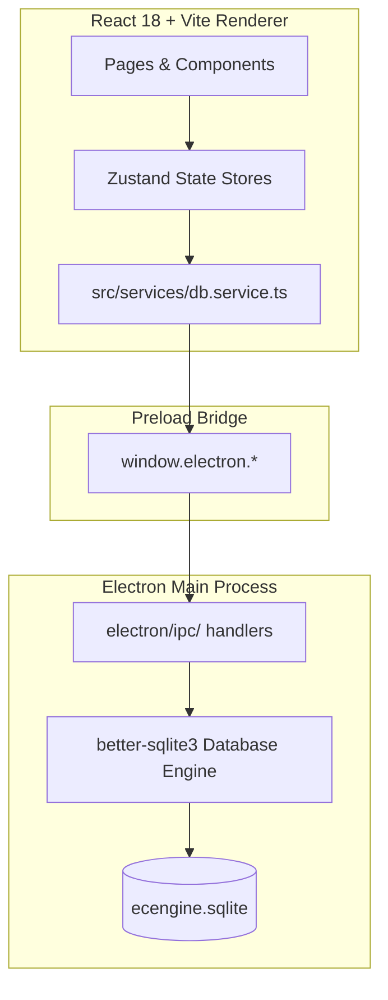

<div align="center">
  
  <h1>⚡ ECEngine</h1>
  <p><strong>The Ultimate Cyberpunk-Utility Study Command Center for the Philippine Electronics Engineering (ECE) & ECT Licensure Exams</strong></p>
  
  <p>
    
    
    
    
    
    
  </p>
</div>

---

**ECEngine** is a native, offline-first desktop application designed specifically for examinees preparing for the Philippine Electronics Engineering (ECE) and Electronics Technician (ECT) Licensure Exams. Powered by a local SQLite database and modern spaced repetition (SM-2), ECEngine provides an integrated command center for reviewing multiple-choice questions (MCQs), flashcards, and LaTeX formula banks with real-time mathematical rendering.

Built with **Electron 31**, **React 18**, **TypeScript**, and **Vite**, state-managed via **Zustand**, and styled with a cyberpunk-inspired Tailwind design system and **Framer Motion** animations.

**Supported Platforms**: Windows, macOS, and Linux — 100% offline and cross-platform.

---

## 🚀 Core Features

### 🧠 Active Recall & Spaced Repetition (SM-2)
* **SuperMemo-2 (SM-2) Scheduling Engine**: Fully implemented spaced repetition algorithm (`src/lib/sm2.ts`) that calculates interval expansions and Ease Factor adjustments based on review quality to maximize long-term retention:
  * **Again (`1` / `< 1m`)**: Full lapse / incorrect recall. Resets consecutive repetitions to `0`, resets interval to `1` day, and applies standard SM-2 Ease Factor penalty ($\text{EF} \ge 1.3$).
  * **Hard (`2` / `~5m`)**: Effortful retrieval. Preserves consecutive repetitions, contracts the interval by 20% ($\max(1, \text{round}(\text{Interval} \times 0.8))$), and decreases Ease Factor.
  * **Good (`3` / `~10m`)**: Successful recall. Increments repetition count; schedules standard interval expansion ($1\text{d} \to 6\text{d} \to \text{round}(\text{Interval} \times \text{EF})$).
  * **Easy (`4` / `4d+`)**: Effortless instant recall. Increments repetition count, computes expanded interval, and grants a bonus $+0.15$ Ease Factor boost (capped at $4.0$).
* **Automated Due Queue & Calendar Scheduling**:
  * Prioritizes unreviewed cards (`next_review IS NULL`) first, followed by due cards (`next_review <= today`) ordered chronologically.
  * Future cards are automatically deferred and filtered out of active sessions until their due date arrives.
  * Provides a dedicated completed/deferred queue screen with actionable feedback when all cards in a deck are scheduled for future review.
* **Ergonomic Hotkeys & Keyboard Navigation**:
  * `1` / `2` / `3` / `4`: Instantly submit SM-2 ratings (`Again`, `Hard`, `Good`, `Easy`) once the card back is revealed or a written answer is submitted.
  * `Space` / `Enter`: Advance to the next card immediately after rating without lifting hands from the keyboard.
  * `Space`, `ArrowUp`, or `ArrowDown`: Flip cards; `ArrowDown` / `ArrowUp` also seamlessly expands and collapses inline solutions/explanations.
  * `←` / `→`: Navigate to the previous card or skip ahead.
  * `F`: Instant hotkey toggle for Term / Definition swapping.
* **Interactive Rating UI & Spring Physics**:
  * Color-coded cyberpunk rating buttons (Red `#FF3333`, Amber `#FFB800`, Green `#00FF41`, Cyan `#00BFFF`) with animated spring transitions, button elevation, and active glow effects.
  * Fixed-height utility slots to eliminate layout shifts and content jumping during card flips and rating feedback.
  * Animated rating confirmation badges with dynamic reset countdown hints and glowing neon-green **Next Card** / **Finish** CTAs.
* **Audio & TTS Synchronization**:
  * Automatic audio cutoff: Rating a card or navigating immediately cancels active Web Speech API or Piper neural TTS streams, preventing voice overlap.
  * Distinct sound effects on card ratings (`correct` tone vs `wrong` alert).
* **Written Mode & Study Controls**:
  * Active typed-answer mode requiring exact input validation and live accuracy tracking before revealing card answers.
  * Study controls for shuffling, bookmarked-only filtering, and term/definition swapping.

---

### 📝 Multiple Choice (MCQ) & "LooksFam" Engine
* **Learn Mode**: Immediate feedback with instant answer validation, detailed solution breakdowns, and AI-powered explanations.
* **Test Mode**: Simulates exam conditions with randomized choice orders, live timer, and a comprehensive end-of-test summary.
* **Bookmarked Items Manager**: Quickly review, preview, and manage bookmarked questions directly from the deck browser with a dedicated legend and modal.
* **Choice Shuffling**: Automatically randomizes options on every run while preserving correct answer mappings.

---

### ⚔️ Gauntlet Mode: Speed, Survival & Elo Ratings
* **High-Octane Arcade Challenge**: Designed for rapid-fire recall and reflex conditioning under pressure, fully isolated from SM-2 spaced repetition, study decks, and attempt logs so you can push your speed without risking your core study intervals.
* **Game Modes**:
  * **Timed Mode ("Beat the Clock")**:
    * Session presets: `1 min`, `2 min`, `3 min`, `5 min`, and `10 min`.
    * Question distribution strategies: **PRC TOS Allocation** (20% MATH, 20% GEAS, 30% ELECS, 30% EST), **Equal Split**, or **Custom Counts**.
    * Dynamic scoring: Combines question weight, answer speed multiplier (up to $1.5\times$ for answering under half par time), and active streak multiplier.
    * **Skip Bank**: Earn $+1$ skip credit for every 20 consecutive correct answers.
  * **Survival Mode ("Sudden Death")**:
    * Starting lives presets: `3 Lives` (high stakes), `5 Lives` (standard), or `10 Lives` (forgiving practice).
    * Per-question time limits: `20s` ($1.25\times$), `30s` ($1.00\times$), `45s` ($0.85\times$), `60s` ($0.70\times$), `2 min` ($0.50\times$), and `Unlimited` (Accuracy Mode).
    * Dynamic difficulty multipliers: Scores and Elo deltas scale automatically based on selected timer and lives.
    * **Life Bonus**: Earn $+1$ life for every 10 consecutive correct answers (capped at starting life count).
    * **Accuracy Mode**: Unlimited per-question timer with minimal score multiplier ($0.08\times$) and strictly capped $\pm 1$ Elo rating adjustments, allowing deep calculation and accuracy validation without rating inflation.
* **Ranked vs. Unranked Runs**:
  * **Ranked**: Tracks per-subject Elo-style ratings across all 4 subjects with provisional rating indicators ($<30$ answers) and official PRC TOS-weighted overall rating score.
  * **Unranked**: Casual practice runs leaving Elo ratings unchanged.
* **Adaptive Cyberpunk Audio & Visuals**:
  * Crossfading dynamic Web Audio background music that scales in intensity across regions (**Stealth**, **Low**, **Med**, **High**, **Boss**).
  * Looping low-health audio overlay and glowing HUD pulse when down to your final life.
* **Comprehensive Post-Run Review**:
  * Two-column tactical breakdown: stats sidebar with accuracy, speed, rating deltas, and score metrics.
  * Filterable question review list (All, Mistakes, Skipped/Timeout, Correct) with inline choices, full mathematical solutions, and one-click "Get Context" clipboard export.

---

### 📐 Mathematical & LaTeX Rendering Engine
* **Hybrid KaTeX + Plain Text Parser**: Supports raw LaTeX, inline `$...$` and block `$$...$$` math, alongside markdown styling (`**bold**`, `*italic*`, `__underline__`).
* **Advanced Super/Subscript Parsing**:
  * Single character: `x^2`, `R_L`
  * Curly braces: `10^{-8}`, `V_{out}`
  * Parenthesized expressions: `e^(v - u)`, `u = ln(e^v + c)`, `f_(n + 1)`
* **ECE Symbol Normalization**: Seamlessly parses non-standard and MathJax symbols into standard KaTeX (e.g. `\phase{}`, `\SI{}{}`, `\ang{}`, `\boldsymbol{}`, `\exponentialE`, `\imaginaryI`).
* **MathLive Equation Editor**: Interactive visual equation editor (Σ button) embedded into card forms with real-time preview and instant text/math mode toggling.

---

### 🖨️ Test Paper & PDF Engine (PrintView)
* **Mock Exam Printouts**: Turn any MCQ, Flashcard, or Formula deck into a high-density, printable exam sheet.
* **3 Layout Modes**:
  * **Glossary**: Clean two-column vertical study list.
  * **Table**: Compact grid with problem and answer/solution columns.
  * **Q&A**: Classic question-and-answer format.
* **Themes**: Switch between **Light**, **Sepia**, and **Dark** (default, with cyber-neon green highlights matching the companion app).
* **Solution & Answer Toggles**: Show or hide answers and detailed solutions with a single click.
* **Find in Document (`Ctrl + F`)**: Integrated search bar with live text highlighting (`<mark>`), occurrence counter, and match stepping.
* **High-Res Image Lightbox**: Click any diagram or solution schematic to expand into a high-resolution lightbox overlay.
* **Themed PDF Export**: Exports clean multi-page PDFs with persistent headers/footers matching the selected paper theme.

---

### 🗂️ Deck Management & Authoring
* **Comprehensive Deck Editor**: Create and edit MCQ, Flashcard, and Formula decks with live previews and image attachment support.
* **Favorite Decks & Instant Filtering**: Star high-priority decks across Study, LooksFam, and Formula banks. Filter favorites with a single click from the Folder panel or Advanced Filters popover.
* **AI-Powered Deck Description**: Auto-generate concise, topic-focused deck descriptions (<12 words) directly in the deck editor using Groq AI (`openai/gpt-oss-120b`).
* **Drag-and-Drop Card Reordering**: Powered by `@dnd-kit`, card order is saved directly to SQLite.
* **Per-Choice LaTeX / Text Toggles**: Specify whether individual choices should render as pure text or LaTeX equations.
* **Collapsible Solutions & Explanations**: Enrich any card with reasoning, derivations, and dedicated solution images.
* **Smart Collision-Aware Tooltips**: Dynamic viewport boundary detection with multi-axis auto-flipping to prevent tooltip clipping in narrow panels and sidebars.
* **Interactive Formatting Guide Modal**: Built-in reference in the editor detailing hotkeys (`Ctrl+B`, `Ctrl+I`, `Ctrl+U`, `Tab`), super/subscripts, and LaTeX syntax.
* **Folder Hierarchy**: Nested folder organization with drag-and-drop ordering and separate namespaces for Study and Formula decks.

---

### 📥 Bulk Import, Migration & Companion App Sync
* **Quizlet Importer**: Paste Quizlet exports directly into the app; automatically detects MCQs vs. Flashcards and applies automatic typo and symbol fixes.
* **Native Plain-Text Format**: Quick bulk creation using clean text blocks separated by blank lines:
  ```text
  Q: What is the unit of magnetic flux density?
  A: Weber
  B: Tesla
  C: Henry
  D: Maxwell
  ANS: B
  ```
* **Full Backup & Selective Export**: Export all decks or cherry-pick specific decks into portable JSON/text archives.
* **Database & Images Export (Companion App Ready)**: One-click export of the active SQLite database (`ecengine.sqlite`) and zipped diagram assets (`ece-images.zip`) to any destination folder for easy offline backup and synchronization with the **ECEngine Android Companion App**.

---

### 📱 ECEngine Android Companion App
* **Study Anywhere**: Transfer your exported `ecengine.sqlite` and `ece-images.zip` directly to your Android device.
* **Unified Cyberpunk Aesthetic**: Consistent dark mode interface with vibrant neon green accents and crisp LaTeX equation rendering.
* **Full Offline Portability**: Access all study decks, question explanations, and schematics on the go without requiring an internet connection.

---

### 📊 Board Exam Tools & Analytics
* **2022 EELE Table of Specifications (ToS) & Cognitive Level Breakdown**:
  * Complete coverage of official PRC Board Examination specifications across **Mathematics**, **Electronics Engineering**, **GEAS**, and **EST**.
  * **Topic & Subject Item Breakdown**: Real-time item counts and proportional difficulty distribution bars (Easy `--tier-easy`, Moderate `--tier-moderate`, Difficult `--tier-difficult`).
  * **Per-Row Exam Item Mapping**: Fine-grained mapping of subtopics to official exam items with cognitive level badges ($K$ Knowledge, $C$ Comprehension, $A$ Application, $An$ Analysis, $S$ Synthesis, $E$ Evaluation).
  * **Grouped Syllabus Accordions**: Subtopic clusters grouped according to PDF specifications with search filtering and instant text highlighting.
* **Interactive Review Checklist**:
  * Synchronously preloaded in-memory state via `useChecklistStore` for instant, flicker-free tab transitions and offline `localStorage` persistence.
  * Multi-column weighted progress tracking: *Review* (10%), *Refresher* (20%), and *Self Review* (70%) with dynamic subject badges and overall progress animations.
* **Activity Heatmap & Trends**: 6-month study activity heatmap, subject accuracy trends, and mastery metrics.
* **Exam Countdown Timer**: Live countdown clock targeting your scheduled Board Exam date.

---

### 🔬 Data Lab: Exploratory Data Analysis (EDA) & Statistics
* **EDA Concepts, Live on Your Review Data**: An interactive Exploratory Data Analysis (EDA) suite that computes real-time inferential and descriptive statistics on question bank composition and personal study telemetry:
  * **Content Coverage vs. PRC TOS Target**: Card counts and topic proportions across **MATH**, **GEAS**, **ELECS**, and **EST** compared directly against official PRC Board Examination TOS target weights (20%, 20%, 30%, 30%).
  * **Mean Question Length by Subject (MCQ)**: Character length metrics per subject with total $N$, library mean, and median values to visualize problem statement right-skewness.
  * **Answer Key Position Balance (MCQ)**: Chi-square goodness-of-fit ($\chi^2$), $p$-value, and Cramér's $V$ effect size tests measuring uniform distribution across choices A (0), B (1), C (2), and D (3) to evaluate option balance.
  * **Question Length: One-Way ANOVA (MCQ)**: One-way Analysis of Variance testing whether question character length differs significantly across exam subjects ($F$-statistic, $p$-value, and degrees of freedom $df_1 / df_2$).
  * **Answer Position vs. Subject Independence**: $4 \times 4$ contingency table and two-way Chi-Square Test of Independence ($\chi^2$, $p$-value, $df = 9$) testing whether correct answer placement is independent of subject category, rendered as a color-coded heatmap intensity grid.
  * **Outlier Detection via Z-Scores**: Library-wide question length standardization ($z = \frac{x - \bar{x}}{s}$) categorizing questions into Typical ($|z| \le 2$), Outlier ($|z| > 2$), and Severe Outlier ($|z| > 3$), identifying extreme questions and their respective subject areas.
  * **Response Time Distribution (MCQ vs. Flashcard)**: Unpooled response latency histograms and separate mean/median review paces comparing timed first-attempt MCQ recall (Learn Mode) against self-paced SM-2 spaced repetition (Flashcard Mode) in dark recessed cyber-styled panels.
* **Interactive Stat Info Modals**: Click any statistical metric tile to open an in-depth modal featuring mathematical formulas rendered in KaTeX, conceptual explanations, and practical review takeaways.
* **In-Memory Caching & Snappy Visualization**: Powered by a dedicated Zustand store (`useDataLabStore`) with background preloading on application launch and automatic cache refresh on study completion or deck imports. Features responsive 3×2 and 2×3 adaptive grids with smooth 600ms ease-out animations and cyber-terminal neon green styling.

---

### 🤖 AI Explanations & Context Generation
* **Groq AI Integration**: Direct integration with Groq (`llama-3.3-70b-versatile` / `openai/gpt-oss-120b`) for on-demand step-by-step problem explanations and automated deck summaries.
* **AI-Powered Deck Summaries**: Single-click auto-generation of crisp deck summaries distilling up to 40 sample cards into clean topic phrases without introductory filler.
* **"Get Context" Exporter**: One-click extraction of formatted problem context to the clipboard for use with ChatGPT, Claude, Gemini, or DeepSeek.
* **Live AI Usage & Rate-Limit Dashboard**: Track Groq API rate limits (requests per minute/day and tokens per minute) in real time from Settings, featuring progress indicators, rate-limit warnings (>85%), and dynamic reset countdown timers.

---

### ⚙️ Settings & System Customization
* **Custom Images Directory**: Select a custom folder for all diagrams and card media with native directory browsing.
* **KaTeX Scale & Bold Mode**: Customize math rendering size (`0.8em` to `1.5em`) and toggle high-contrast KaTeX bold mode.
* **Global App Zoom**: Scale the UI (`80%` – `130%`) with `Ctrl+=`, `Ctrl+-`, `Ctrl+0`, and `Ctrl + Mouse Wheel`.
* **Database Management & Export**: View active SQLite file path, switch database location, or export database + zipped images to a directory with a single click.
* **Master Audio Volume & SFX Settings**: Global SFX volume slider (`VolumeControl`), persistent sound levels, and customizable wrong-answer meme audio ("faah sound meme" vs synthesized alert).
* **Cross-Platform TTS Settings**: Configurable speech rate, voice selection, and Linux Piper ONNX neural voice model management.
* **AI Telemetry & Rate-Limit Tracking**: Antigravity-inspired usage tracker with real-time percentage indicators and reset timers for your configured Groq API key.

---

## 📝 Formatting & Math Cheatsheet

Text fields across questions, choices, formulas, and explanations support inline Markdown and LaTeX:

| Syntax | Description | Example Output |
|---|---|---|
| `**text**` (or `Ctrl+B`) | Bold | **text** |
| `*text*` (or `Ctrl+I`) | Italic | *text* |
| `__text__` (or `Ctrl+U`) | Underline | <u>text</u> |
| `x^2` / `R_L` | Single-character super/subscript | x², R<sub>L</sub> |
| `10^{-8}` / `V_{out}` | Multi-character super/subscript (braces) | 10⁻⁸, V<sub>out</sub> |
| `e^(v - u)` / `f_(n + 1)` | Expression super/subscript (parentheses) | e<sup>(v - u)</sup>, f<sub>(n + 1)</sub> |
| `$\sin\theta$` | Inline LaTeX equation | $\sin\theta$ |
| `$$E = mc^2$$` | Centered display block equation | $$E = mc^2$$ |
| `\phase{30}` | Electrical angle / phasor | $\angle 30^{\circ}$ |
| `\SI{10}{k\Omega}` | SI unit formatting | $10\text{ k}\Omega$ |

---

### ⌨️ Flashcard Study & Navigation Hotkeys

| Key | Action | Context / Behavior |
|---|---|---|
| `Space` / `↑` / `↓` | **Flip Card** | Toggle between card Front and Back |
| `↓` (Arrow Down) | **Expand Explanation** | Open collapsible step-by-step solution / AI breakdown (when flipped) |
| `↑` (Arrow Up) | **Collapse Explanation** | Close collapsible explanation and restore card focus |
| `1` | **Again** (`< 1m`) | Reset repetitions to 0, reset interval to 1d, apply EF penalty |
| `2` | **Hard** (`~5m`) | Retain repetitions, contract interval by 20%, decrease EF |
| `3` | **Good** (`~10m`) | Advance repetition stage (1d $\to$ 6d $\to$ $\text{Int} \times \text{EF}$), adjust EF |
| `4` | **Easy** (`4d+`) | Advance repetition stage with bonus $+0.15$ Ease Factor boost |
| `Space` / `Enter` | **Next Card** | Advance to next scheduled card after rating |
| `←` / `→` | **Prev / Skip** | Navigate to previous card or skip current card without rating |
| `F` | **Swap Term / Def** | Toggle between Term $\to$ Definition and Definition $\to$ Term |

---

## 🏗 System Architecture

ECEngine runs as an Electron desktop application where the React UI connects to a local SQLite database via asynchronous Electron IPC channels.



### Database Schema Overview

```sql
-- Topic / Deck metadata
CREATE TABLE topics (
  id TEXT PRIMARY KEY,
  name TEXT NOT NULL,
  subject TEXT NOT NULL,
  description TEXT DEFAULT '',
  parent_id TEXT REFERENCES topics(id),
  order_index INTEGER DEFAULT 0,
  tags TEXT DEFAULT '[]',
  folder_name TEXT DEFAULT 'Uncategorized',
  folder_id TEXT REFERENCES folders(id) ON DELETE SET NULL,
  is_favorite BOOLEAN DEFAULT 0,
  created_at INTEGER DEFAULT (strftime('%s', 'now'))
);

-- Card items (MCQ, Flashcard, Formula)
CREATE TABLE cards (
  id TEXT PRIMARY KEY,
  topic_id TEXT NOT NULL,
  type TEXT NOT NULL,          -- 'mcq' | 'flashcard' | 'formula'
  data TEXT NOT NULL,          -- JSON payload of question/choices/latex/explanation
  difficulty TEXT DEFAULT 'medium',
  tags TEXT DEFAULT '[]',
  is_custom BOOLEAN DEFAULT 0,
  order_index INTEGER DEFAULT 0,
  created_at INTEGER DEFAULT (strftime('%s', 'now')),
  FOREIGN KEY(topic_id) REFERENCES topics(id) ON DELETE CASCADE
);

-- SM-2 Spaced Repetition progress
CREATE TABLE progress (
  card_id TEXT PRIMARY KEY,
  ease_factor REAL DEFAULT 2.5,
  interval INTEGER DEFAULT 1,
  repetitions INTEGER DEFAULT 0,
  next_review TEXT,
  last_reviewed TEXT,
  correct_count INTEGER DEFAULT 0,
  total_count INTEGER DEFAULT 0,
  last_result TEXT,
  FOREIGN KEY(card_id) REFERENCES cards(id) ON DELETE CASCADE
);

-- Folder hierarchy for deck organization
CREATE TABLE folders (
  id TEXT PRIMARY KEY,
  name TEXT NOT NULL,
  parent_id TEXT REFERENCES folders(id),
  order_index INTEGER DEFAULT 0,
  scope TEXT NOT NULL DEFAULT 'study' -- 'study' | 'formula'
);

-- Optimization Indexes
CREATE INDEX IF NOT EXISTS idx_next_review ON progress(next_review);
CREATE INDEX IF NOT EXISTS idx_last_reviewed ON progress(last_reviewed);
CREATE INDEX IF NOT EXISTS idx_cards_topic_id ON cards(topic_id);
CREATE INDEX IF NOT EXISTS idx_topics_folder_id ON topics(folder_id);
CREATE INDEX IF NOT EXISTS idx_topics_subject ON topics(subject);
CREATE INDEX IF NOT EXISTS idx_topics_is_favorite ON topics(is_favorite);

-- Daily activity tracking
CREATE TABLE study_activity (
  day TEXT PRIMARY KEY,        -- YYYY-MM-DD
  count INTEGER DEFAULT 0,
  time_spent INTEGER DEFAULT 0,
  correct_count INTEGER DEFAULT 0,
  total_count INTEGER DEFAULT 0
);

-- Mock exam records
CREATE TABLE exam_sessions (
  id TEXT PRIMARY KEY,
  topic_id TEXT,
  mode TEXT,
  started_at TEXT,
  finished_at TEXT,
  score INTEGER DEFAULT 0,
  total INTEGER DEFAULT 0,
  answers TEXT DEFAULT '{}'
);

-- Attempt telemetry for response time & performance analysis
CREATE TABLE attempt_log (
  id INTEGER PRIMARY KEY AUTOINCREMENT,
  card_id TEXT NOT NULL,
  session_id TEXT,
  mode TEXT NOT NULL,          -- 'learn' | 'flashcard' | 'test'
  response_ms INTEGER NOT NULL,
  result TEXT,
  created_at INTEGER NOT NULL,
  FOREIGN KEY(card_id) REFERENCES cards(id) ON DELETE CASCADE
);

-- Gauntlet high-stakes speed runs & answers
CREATE TABLE gauntlet_runs (
  id TEXT PRIMARY KEY,
  started_at INTEGER NOT NULL,
  ended_at INTEGER NOT NULL,
  mode TEXT NOT NULL,          -- 'timed' | 'survival'
  config TEXT NOT NULL,
  rated INTEGER NOT NULL DEFAULT 0,
  score INTEGER NOT NULL,
  answered INTEGER NOT NULL,
  correct INTEGER NOT NULL,
  wrong INTEGER NOT NULL,
  skipped INTEGER NOT NULL,
  best_streak INTEGER NOT NULL,
  duration_ms INTEGER NOT NULL,
  end_reason TEXT NOT NULL
);

CREATE TABLE gauntlet_answers (
  id INTEGER PRIMARY KEY AUTOINCREMENT,
  run_id TEXT NOT NULL,
  seq INTEGER NOT NULL,
  card_id TEXT NOT NULL,
  subject TEXT NOT NULL,
  outcome TEXT NOT NULL,       -- 'correct' | 'wrong' | 'skipped' | 'timeout'
  time_ms INTEGER NOT NULL,
  par_ms INTEGER NOT NULL,
  points INTEGER NOT NULL,
  streak_after INTEGER NOT NULL
);

-- Gauntlet Elo-style subject ratings
CREATE TABLE gauntlet_ratings (
  subject TEXT PRIMARY KEY,    -- 'MATH' | 'GEAS' | 'ELECS' | 'EST'
  rating REAL NOT NULL,
  answers INTEGER NOT NULL DEFAULT 0,
  peak REAL,
  updated_at INTEGER NOT NULL
);
```

---

## 📂 Project Structure

```text
ecengine/
├── electron/                    # Electron Backend Process
│   ├── main.ts                  # App lifecycle, window management, zoom, hotkeys
│   ├── preload.ts               # contextBridge IPC API exposure
│   ├── db/                      # SQLite connection, schema bootstrap, migrations (v1–v9)
│   └── ipc/                     # Modular IPC handlers (DB, Deck, Analytics, AI, Print, Config, TTS, Export)
├── src/                         # React Frontend (Renderer)
│   ├── assets/                  # Brand assets, icons, bundled fonts (Rajdhani, JetBrains Mono, Orbitron)
│   ├── components/              # Modular UI Components
│   │   ├── ui/                  # Tooltip (auto-flipping), VolumeControl, FolderPanel, Toast, TOSTracker
│   │   ├── gauntlet/            # GauntletHome, GauntletSetup, GauntletBackdrop, RatingsPanel, RunHistory, GauntletFaqModal
│   │   ├── mcq/                 # MCQCard, LearnMode, TestMode, BookmarkedCardsModal
│   │   ├── flashcard/           # FlashcardSession, FlashcardDeckBrowser, StudyCard
│   │   ├── deck/                # CardForms, DeckCard, AIDescriptionButton, AdvancedFiltersPopover
│   │   ├── study/               # StudyHeader, StudySessionStats
│   │   ├── dashboard/           # ReviewHeatmap, SessionHistory, ExamCountdown
│   │   ├── stats/demos/         # Data Lab EDA demos (ContentCoverage, QuestionLength, ANOVA, Contingency, Z-Score, ResponseTime, StatInfoModal)
│   │   ├── toc/                 # SubjectCard, Table of Specifications data, tosItems, tosRows
│   │   └── layout/              # AppShell, custom TitleBar, navigation sidebar
│   ├── hooks/                   # Business logic (SM-2, timer, TTS, useGauntletMusic, sound volume, import)
│   ├── lib/                     # LaTeX rendering, subject classifier, audio synthesis, gauntlet scoring/Elo, tosData
│   │   └── stats/               # In-house statistical analysis suite (ANOVA, Chi-Square, descriptive, distributions, inference)
│   ├── pages/                   # Main views (Dashboard, Gauntlet, Lab, LooksFam, FlashcardLearn, Formulas, PrintView, TOSChecklist, Settings)
│   ├── services/                # db.service.ts (SQLite data access), aiSummary.service.ts (Groq summaries)
│   ├── store/                   # Zustand stores (useSessionStore, useGauntletStore, useChecklistStore, useDataLabStore)
│   └── styles/                  # Tailwind theme tokens, CSS variables (--tier-*), KaTeX customizations
├── content/                     # Seed JSON deck files
├── scripts/                     # Seeding and content validation scripts
├── package.json                 # Dependencies and build configuration
├── tailwind.config.ts           # Semantic design tokens and container queries
└── electron.vite.config.ts      # Vite configuration for React and Electron
```

---

## 🛠 Getting Started & Development

### Prerequisites
* **Node.js**: `v20.x` or `v22.x` LTS recommended
* **npm** (comes with Node.js)
* **C++ Build Tools**:
  * **Windows**: `npm install --global --production windows-build-tools` or Visual Studio C++ build tools (required for native `better-sqlite3` compilation)
  * **Linux**: `build-essential`, `python3`
  * **macOS**: Xcode Command Line Tools (`xcode-select --install`)

---

### Installation & Database Seeding

1. **Clone the repository**:
   ```bash
   git clone https://github.com/vtajaros/ECEngine.git
   cd ecengine
   ```

2. **Install dependencies**:
   ```bash
   npm install
   ```

3. **Compile and seed the database**:
   > ⚠️ **Note on ABI Targets**: Seeding runs via system Node.js, while the app runs via Electron's bundled Node.js. Follow this sequence:
   ```bash
   # Rebuild native sqlite bindings for system Node.js
   npm rebuild better-sqlite3

   # Seed content/ JSON decks into ecengine.sqlite
   npm run seed

   # Rebuild native sqlite bindings for Electron
   npx electron-rebuild -f
   ```

4. **Launch development mode**:
   ```bash
   npm run dev
   ```

---

### 🔊 Linux TTS Setup (Optional)

On Windows and macOS, ECEngine uses the operating system's built-in Web Speech API with zero configuration. On Linux, fast, high-quality neural voice synthesis is powered by [Piper](https://github.com/rhasspy/piper) and ALSA (`aplay`).

#### 1. Install Piper & Audio Tools by Distro

Choose the method that matches your Linux distribution:

<details open>
<summary><b>Ubuntu / Debian / Linux Mint / Pop!_OS / Zorin OS</b></summary>

```bash
# 1. Install audio utility dependencies
sudo apt update && sudo apt install -y alsa-utils wget tar

# 2. Download and install precompiled Piper binary
wget https://github.com/rhasspy/piper/releases/latest/download/piper_linux_x86_64.tar.gz
tar -xzf piper_linux_x86_64.tar.gz
sudo cp -r piper/* /usr/local/
rm -rf piper piper_linux_x86_64.tar.gz
```

*Alternative via pipx:*
```bash
sudo apt install -y pipx alsa-utils
pipx install piper-tts
pipx ensurepath
```
</details>

<details open>
<summary><b>Fedora / RHEL / Nobara / Rocky Linux / AlmaLinux</b></summary>

```bash
# 1. Install audio utility dependencies
sudo dnf install -y alsa-utils wget tar

# 2. Download and install precompiled Piper binary
wget https://github.com/rhasspy/piper/releases/latest/download/piper_linux_x86_64.tar.gz
tar -xzf piper_linux_x86_64.tar.gz
sudo cp -r piper/* /usr/local/
rm -rf piper piper_linux_x86_64.tar.gz
```

*Alternative via pipx:*
```bash
sudo dnf install -y pipx alsa-utils
pipx install piper-tts
pipx ensurepath
```
</details>

<details open>
<summary><b>Arch Linux / Manjaro / EndeavourOS</b></summary>

```bash
# Install via AUR helper (yay or paru)
yay -S piper-tts-bin alsa-utils
# or: paru -S piper-tts-bin alsa-utils
```
</details>

<details>
<summary><b>openSUSE (Tumbleweed / Leap)</b></summary>

```bash
# 1. Install audio utility dependencies
sudo zypper install -y alsa-utils wget tar

# 2. Download and install precompiled Piper binary
wget https://github.com/rhasspy/piper/releases/latest/download/piper_linux_x86_64.tar.gz
tar -xzf piper_linux_x86_64.tar.gz
sudo cp -r piper/* /usr/local/
rm -rf piper piper_linux_x86_64.tar.gz
```
</details>

<details>
<summary><b>Universal (Any Distro via Python pipx)</b></summary>

```bash
# Install pipx from your system package manager, then:
pipx install piper-tts
pipx ensurepath
```
</details>

---

#### 2. Download ONNX Voice Models

Piper requires an `.onnx` voice model and its matching `.onnx.json` configuration file. ECEngine automatically scans `~/.local/share/piper-voices/` on startup.

Run the following commands to create the directory and download the recommended natural voice (**Ryan - Medium**):

```bash
mkdir -p ~/.local/share/piper-voices && cd ~/.local/share/piper-voices

# Download Ryan Medium (recommended)
wget https://huggingface.co/rhasspy/piper-voices/resolve/main/en/en_US/ryan/medium/en_US-ryan-medium.onnx
wget https://huggingface.co/rhasspy/piper-voices/resolve/main/en/en_US/ryan/medium/en_US-ryan-medium.onnx.json
```

> 💡 **Want other voices?** Browse additional English and international voices on the [Piper HuggingFace Voice Library](https://huggingface.co/rhasspy/piper-voices/tree/main/en/en_US) (e.g. `amy`, `lessac`, `danny`, `bryce`). Simply download both the `.onnx` and `.onnx.json` files into `~/.local/share/piper-voices/`.

---

#### 3. Configuration & Verification

* **Automatic Detection**: If you downloaded the voice model into `~/.local/share/piper-voices/`, ECEngine detects and selects it automatically upon startup.
* **Manual Model Selection**: You can also browse for any `.onnx` file in **Settings** → **Sound & Feedback** → **Reading Voice (Piper TTS)** → **Browse**.
* **Quick CLI Verification**: Test your installation directly in the terminal:
  ```bash
  echo "ECEngine neural text-to-speech is ready." | piper --model ~/.local/share/piper-voices/en_US-ryan-medium.onnx --output_file - | aplay
  ```

---

### 💻 Developer Command Reference

| Command | Description |
|---|---|
| `npm run dev` | Launch Electron app in development mode with Hot Module Replacement (HMR) |
| `npm run build` | Compile TypeScript and bundle renderer & main process assets |
| `npm run preview` | Preview production build locally |
| `npm run package` | Generate distributable installers (`.exe`, `.AppImage`, `.dmg`) via `electron-builder` |
| `npm run seed` | Parse `content/` JSON files and populate `ecengine.sqlite` |
| `npm run validate-content` | Validate JSON structure and questions in `content/` |
| `npm run test` | Run test suite with Vitest |

---

## 📐 Key Design Principles

1. **Strict Offline First**: No external servers are required for core features. All decks, progress, and history remain on the user's local disk.
2. **Unified Cyberpunk Typography**:
   * **Orbitron**: Display headers, page titles, hero text, and alert banners.
   * **Rajdhani**: Primary application UI, navigation, buttons, badges, MCQ cards, flashcards, and Test Paper View.
   * **JetBrains Mono**: All monospace data, numbers, charts, table reviews, code editors, AI explanations, and choice prefixes (`[A]`, `[B]`, `[C]`, `[D]`). *(Note: Replaced legacy IBM Plex Mono)*.
3. **No Arbitrary Hex Colors**: UI components must use established CSS variables in `src/styles/theme.css` and Tailwind semantic classes (`bg-surface`, `border-border-base`, `text-accent`, etc.).
4. **Separated Service Boundary**: React components query database operations through `src/services/db.service.ts` rather than invoking raw Electron IPCs directly.
5. **Resilient KaTeX Rendering**: KaTeX math blocks are sanitized and normalized safely without running through DOMPurify SVG-corrupting filters.

---

<div align="center">
  <i>Engineered for our future Electronics Engineers & Electronics Technicians.</i>
</div>
